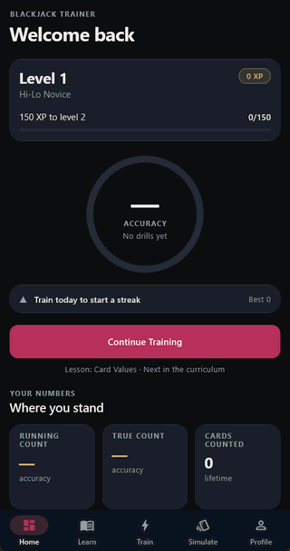
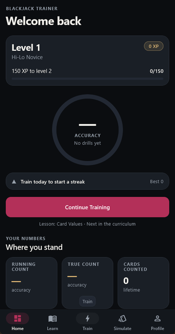
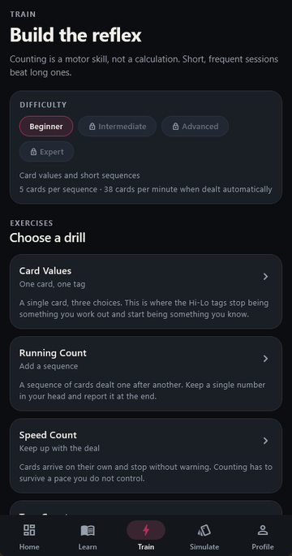
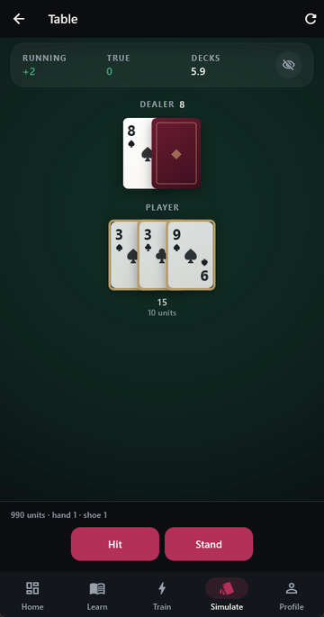
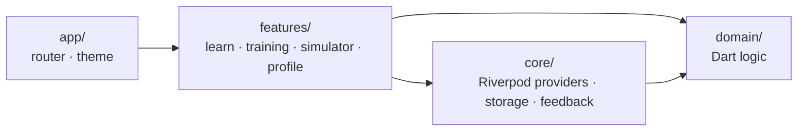

# Blackjack Trainer

An offline Flutter app that teaches the Hi-Lo card counting system: short lessons, timed drills, and a full blackjack table to count through.

**[Try it in your browser](https://berkste.github.io/blackjack/)** · **[Download the Android APK](https://github.com/Berkste/blackjack/releases/latest)**

> **Educational tool. No real money, no gambling.** The simulator uses practice units only. It never connects to a casino, takes payments or offers wagers.

<p align="center">
  
</p>

| Home | Train | Simulate |
|---|---|---|
|  |  |  |

> This is the showcase repository: screenshots, the live demo, the APK and the pure Dart core with its tests. The full app source is kept private.

## Features

- **Learn:** six lessons (card values, running count, true count, deck estimation, basic strategy, count-based deviations). Each has worked examples you step through card by card. Later lessons unlock as you progress.
- **Strategy chart:** the full basic strategy grid (hard totals, soft totals, pairs). Tap a cell to see why that play is correct.
- **Train:** six timed, scored drills:
  - Card Values
  - Running Count
  - Speed Count
  - True Count
  - Deck Estimation
  - Full Counting Drill

  Four difficulty levels, from Beginner to Expert.
- **Simulate:** a complete blackjack table:
  - configurable rules: decks, dealer hits soft 17, double after split, surrender, penetration
  - hit, stand, double, split, surrender, insurance
  - running count, true count and decks remaining stay hidden until you peek
  - optional basic-strategy and index-play hints
- **Progress:** XP, levels, a daily streak, badges, statistics and a suggested next step. Everything is stored on the device.
- **Accessibility:** a reduced-motion setting, adjustable card animation speed, a high-contrast theme, and text scaling clamped to what the layouts support.

## Architecture

The card-counting and blackjack logic lives in a pure Dart `domain/` layer, so it is tested without widgets. It is published here as the [`core/`](core/) package.



```
lib/
├── app/        app shell, go_router routes, theme
├── core/       providers, shared_preferences storage, haptics and sound
├── domain/     Dart logic: cards, shoe, counting, blackjack rules, strategy, progress
├── features/   onboarding, home, learn, training, simulator, profile
└── shared/     reusable widgets and card animations
```

Key parts of `domain/`:

| File | What it does |
|---|---|
| `models/shoe.dart` | Multi-deck shoe with a cut card at the configured penetration. |
| `counting/hi_lo_counter.dart` | Hi-Lo tags (2–6 = +1, 7–9 = 0, 10–A = −1) and the running count. |
| `counting/true_count_calculator.dart` | True count = running count ÷ decks remaining, with selectable rounding. |
| `blackjack/blackjack_game.dart` | Round state machine: betting, insurance, player turn, dealer turn, settlement. |
| `blackjack/basic_strategy.dart` | Basic strategy for hard, soft and pair hands under the configured rules. |
| `blackjack/count_deviations.dart` | The Illustrious 18: index plays that override basic strategy at a given true count. |
| `progress/progress_engine.dart` | XP, levels, streaks, badges and lesson unlocking. |

## Tests

The full app has 259 tests and all of them pass; `flutter analyze` reports no issues. The 206 domain tests are included in this repository under [`core/test/domain`](core/test/domain).

| Suite | File | Tests |
|---|---|---|
| Domain | `progress_engine_test.dart` | 40 |
| | `blackjack_game_test.dart` | 39 |
| | `basic_strategy_test.dart` | 38 |
| | `hand_test.dart` | 24 |
| | `hi_lo_counter_test.dart` | 20 |
| | `true_count_test.dart` | 17 |
| | `shoe_test.dart` | 15 |
| | `drill_generator_test.dart` | 13 |
| Widget flows | `simulator_flow_test.dart` | 15 |
| | `drill_flow_test.dart` | 13 |
| | `navigation_test.dart` | 13 |
| | `lesson_flow_test.dart` | 12 |

## The core package

[`core/`](core/) is the `domain/` layer as a standalone Dart package with no Flutter dependency: cards, the shoe, Hi-Lo counting, the true count, the blackjack round state machine, basic strategy, the Illustrious 18 deviations and the progress engine. The lesson content the progress tests rely on is included too.

```sh
cd core
dart pub get
dart test
```

## Known limitations

- **Riverpod 2 API.** State uses Riverpod 2's `StateNotifierProvider`. It has not been migrated to Riverpod 3 `Notifier`s yet.
- **Hi-Lo only.** Other counting systems, such as KO, Omega II and Zen, are not included.
- **No bet-sizing coach.** The simulator shows the true count but does not coach bet sizing by count.
- **Single player.** The table seats one player against the dealer. No other players take cards from the shoe.

## Tech stack

Flutter 3.47 · Dart 3.13 · Riverpod · go_router · `shared_preferences` · fully offline, no backend.

## License

[MIT](LICENSE).
